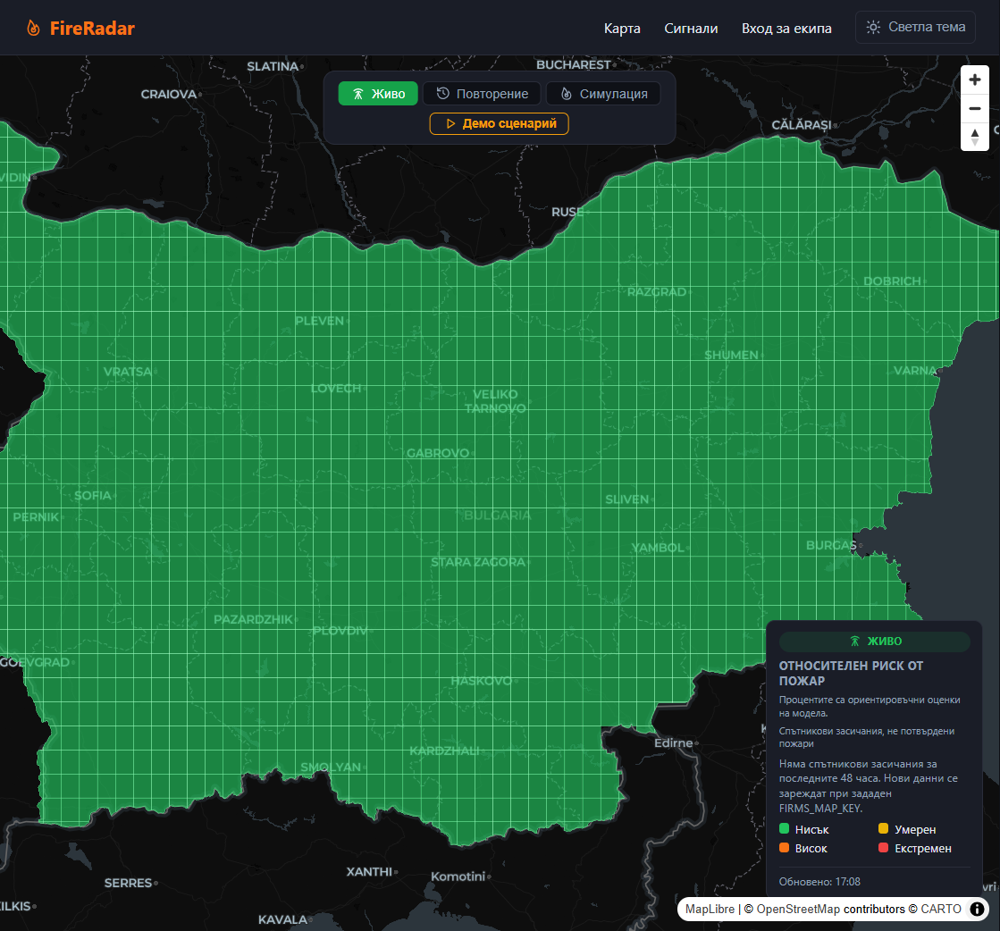
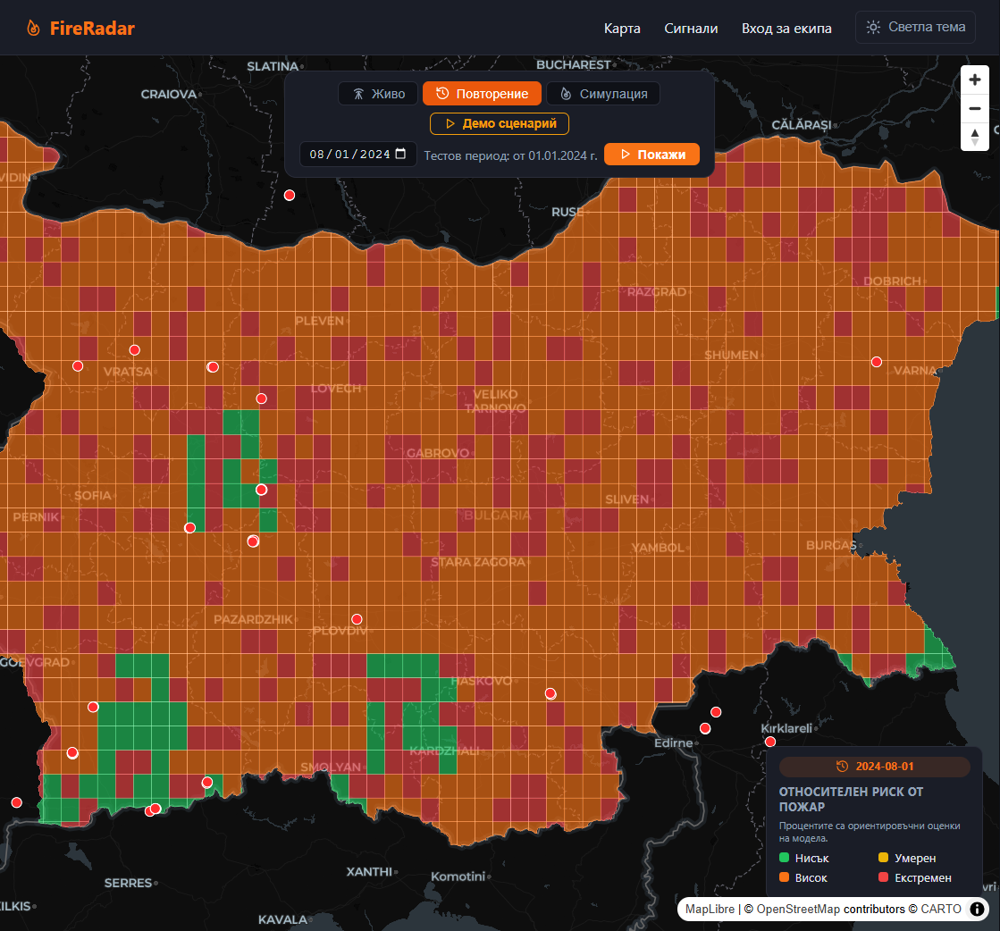
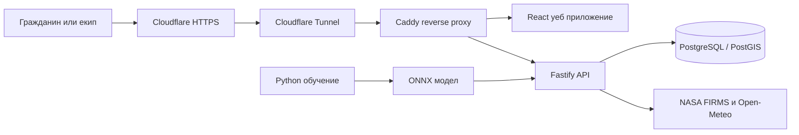

# FireRadar


**FireRadar е система за наблюдение и ранно предупреждение при горски пожари в България.**

> **Жива демонстрация:** [fireradar-bg.org/map](https://fireradar-bg.org/map). Екипният вход е на [admin.fireradar-bg.org](https://admin.fireradar-bg.org). Публичният сайт се обслужва през Cloudflare с HTTPS.

## Проблем и решение

Горските пожари могат да се разпространят бързо, а навременната оценка на условията и сигналите от терен е важна за ранната реакция. FireRadar събира на една карта метеорологични данни, сателитни засичания и оценка на пожарния риск, за да подпомогне наблюдението на територията на България. Публичната част позволява на гражданите да преглеждат картата и да подават сигнали, а отделният интерфейс е предназначен за диспечери и администратори. Системата е прототип за демонстрация и подпомагане на решения, а не заместител на официалните служби или канал за спешни повиквания.

## Изгледи

### Карта в текущ режим



### Историческо повторение



Оперативният панел е защитен и изисква екипен акаунт. В хранилището няма споделени демо идентификационни данни и затова тук не е публикуван негов скрийншот. Не използвайте реални производствени акаунти за публична демонстрация.

## Основни възможности

- Интерактивна карта на България с клетки за оценка на риска и светла/тъмна тема.
- Текущ изглед, исторически режим на повторение и учебна симулация на разпространение на огън.
- Интеграция със сателитни засичания NASA FIRMS/VIIRS и исторически данни.
- Метеорологични данни от Open-Meteo, изчисление на Fire Weather Index (FWI) и прогнози за следващите три дни.
- LightGBM модел, експортиран в ONNX, за оценка на относителния риск.
- Анонимно подаване на граждански сигнали с проверка на местоположението и Cloudflare Turnstile.
- Защитен оперативен интерфейс за обработка на сигнали и демо наблюдателни кули и дронове.
- Администраторски функции за управление на потребители, журнал на действията и сензорни ключове.

## Технологии и архитектура

**React · TypeScript · MapLibre · Fastify · PostgreSQL/PostGIS · Python · LightGBM · ONNX · Docker Compose · Cloudflare Tunnel**



За подробности относно потока на данните, API, базата, ограниченията и deployment-а виж [техническия справочник](PROJECT_GUIDE.md).

## Данни и източници

Проектът не включва всички входни данни в Git. За пълно локално стартиране трябва да бъдат подготвени следните файлове в `data/`:

| Файл | Източник / предназначение |
|---|---|
| `bulgaria_boundary.geojson` | Граница на България; изтегля се със скрипта за геоданни от GADM. |
| `clc2018_bgr.geojson` | CORINE Land Cover 2018 за България; изтегля се от услугата на Европейската агенция по околна среда. |
| `firms_bulgaria_2018_2025.csv` | Исторически VIIRS засичания от NASA FIRMS; изтеглят се с личен FIRMS API ключ. |
| `meteo_2018_2024.csv` | Кеш за обучението на модела; създава се от `ml/train.py`, ако липсва. |

Геоданните и историческият FIRMS CSV се изтеглят с тези скриптове от главната папка:

```powershell
python -m pip install -r requirements.txt
python .\download_geodata.py
$env:FIRMS_KEY = Read-Host "NASA FIRMS API key"
python .\download_firms_full.py --firms-key $env:FIRMS_KEY
Remove-Item Env:FIRMS_KEY
```

Linux/macOS:

```bash
python3 -m pip install -r requirements.txt
python3 download_geodata.py
read -rp "NASA FIRMS API key: " FIRMS_KEY
python3 download_firms_full.py --firms-key "$FIRMS_KEY"
unset FIRMS_KEY
```

Заявете ключ от [NASA FIRMS](https://firms.modaps.eosdis.nasa.gov/api/area/). Не записвайте ключа в Git. При първоначалното стартиране на API географските клетки се генерират от границата и CORINE данните. За почасово обновяване на последните FIRMS засичания е необходима отделна променлива `FIRMS_MAP_KEY`.

Файловете с данни са изключени от Git чрез `.gitignore`. Не е зададено споделено хранилище или линк за свалянето им; потребителят трябва да ги генерира локално чрез скриптовете.

## Бързо локално стартиране

За пълното локално стартиране са необходими Docker Compose и Python 3 за подготовка на данните. Node.js 22 или по-нова версия е необходима за локална разработка и тестове, но не и за стартиране чрез Docker Compose. Първо изтеглете данните от предишната секция, след това създайте `.env` в главната папка:

```env
JWT_SECRET=<дълга-случайна-тайна>
POSTGRES_PASSWORD=<силна-уникална-парола-за-базата>
ALLOWED_ORIGINS=http://localhost:5173,http://admin.localhost:5173
```

Стартирайте услугите:

```bash
docker compose up --build
```

- Публична карта и сигнали: <http://localhost:5173>
- Защитен екипен панел: <http://admin.localhost:5173>
- API: <http://localhost:3001>
- Swagger документация: <http://localhost:3001/docs>

Потребителски акаунти не се създават автоматично. За вход в екипния панел създайте локални акаунти след стартиране на базата с `npm run provision:users` — командите са в секцията [Създаване на екипни акаунти](#създаване-на-екипни-акаунти). За изпращане на сигнали задайте Cloudflare Turnstile site key и secret key; без тях подаването е изключено.

## Демо акаунти

Хранилището **не съдържа общи демо потребителски имена или пароли**. Това е умишлено: seed-ът не създава акаунти с известни пароли. За локална демонстрация създайте отделни акаунти със собствени имейли и пароли по инструкциите по-долу. Не публикувайте тези данни в README, GitHub Issues или кода. За комисията създайте отделни временни демо акаунти и ги предоставете по защитен канал, ако е необходимо.

## Създаване на екипни акаунти

След като базата е готова, provision скриптът създава или обновява отделен администраторски и диспечерски акаунт. Паролите трябва да са поне 14 знака. Не използвайте производствени пароли за демонстрация.

PowerShell:

```powershell
$env:ADMIN_EMAIL = Read-Host "Admin email"
$env:ADMIN_PASSWORD = Read-Host "Admin password"
$env:DISPATCHER_EMAIL = Read-Host "Dispatcher email"
$env:DISPATCHER_PASSWORD = Read-Host "Dispatcher password"
docker compose exec -e ADMIN_EMAIL -e ADMIN_PASSWORD -e DISPATCHER_EMAIL -e DISPATCHER_PASSWORD api npm run provision:users
Remove-Item Env:ADMIN_EMAIL, Env:ADMIN_PASSWORD, Env:DISPATCHER_EMAIL, Env:DISPATCHER_PASSWORD
```

Linux/macOS:

```bash
read -rp "Admin email: " ADMIN_EMAIL
read -rsp "Admin password: " ADMIN_PASSWORD; echo
read -rp "Dispatcher email: " DISPATCHER_EMAIL
read -rsp "Dispatcher password: " DISPATCHER_PASSWORD; echo
export ADMIN_EMAIL ADMIN_PASSWORD DISPATCHER_EMAIL DISPATCHER_PASSWORD
docker compose exec -e ADMIN_EMAIL -e ADMIN_PASSWORD -e DISPATCHER_EMAIL -e DISPATCHER_PASSWORD api npm run provision:users
unset ADMIN_EMAIL ADMIN_PASSWORD DISPATCHER_EMAIL DISPATCHER_PASSWORD
```

Скриптът премахва legacy акаунта `citizen@fireradar.bg`, ако съществува, като запазва свързаните сигнали. Не съхранявайте пароли в Git или в shell history.

## Тестове и проверки

```bash
# API тестове и компилация
cd api
npm ci
npm test
npm run build

# Уеб приложение: статичен анализ и production build
cd ../web
npm ci
npm run lint
npm run build

# Тестове на ML обработката
cd ..
python -m unittest ml.test_train
```

GitHub Actions изпълнява API тестове и компилация, web lint и build, както и Docker image builds при push към `main` и при pull request. CI значката е в началото на този документ.

## Ограничения

- ML резултатът е **относителен риск**, а не калибрирана абсолютна вероятност за пожар. Метриките и методологията са описани в [резултатите от ML модела](results.md).
- Метеорологичните данни се вземат от представителни точки през приблизително 0,5° географска мрежа и клетките използват данните от най-близката точка. Затова съседни области могат да имат еднакви входни метеорологични стойности и по картата да се виждат правилни на вид цветни зони; това е ограничение на пространствената резолюция, не доказателство за еднакви локални условия. По-гъста метеорологична мрежа или интерполация е възможна следваща стъпка.
- NASA FIRMS показва сателитни hotspot засичания; те могат да включват и непожарни източници и не представляват потвърден пожар. Наличието на живи точки зависи от валиден `FIRMS_MAP_KEY`.
- Наблюдателните кули, сигналите от тях и дроновете са демо/симулационни данни; няма връзка с физически устройства или реална диспечерска система.
- Данните и моделът подпомагат наблюдение и демонстрация, но не трябва да се използват като единствена основа за реални действия при пожар. При опасност се свържете с официалните служби.

## Публикувана демонстрация и deployment

Живата демонстрация е достъпна на [fireradar-bg.org](https://fireradar-bg.org/map), а екипният панел — на [admin.fireradar-bg.org](https://admin.fireradar-bg.org). Production трафикът минава през Cloudflare HTTPS и Cloudflare Tunnel към Caddy; Caddy препраща заявките към web приложението и API. Конфигурацията за тунела е в [docker-compose.yml](docker-compose.yml), а вътрешното маршрутизиране — в [Caddyfile](Caddyfile).

За ново или възстановено production разгръщане използвайте сървърни, уникални тайни в `.env`:

```env
JWT_SECRET=<нова-дълга-случайна-тайна>
POSTGRES_PASSWORD=<нова-силна-парола>
ALLOWED_ORIGINS=https://fireradar-bg.org,https://www.fireradar-bg.org,https://admin.fireradar-bg.org
VITE_TURNSTILE_SITE_KEY=<Turnstile-site-key>
TURNSTILE_SECRET_KEY=<Turnstile-secret-key>
FIRMS_MAP_KEY=<NASA-FIRMS-map-key>
TUNNEL_TOKEN=<Cloudflare-Tunnel-token>
```

1. Настройте hostname маршрутите в Cloudflare Tunnel към Caddy на порт 80 и добавете production hostnames към настройките на Turnstile.
2. Създайте администраторски и диспечерски акаунти чрез provisioning скрипта.
3. Проверете `.env` и стартирайте услугите:

   ```bash
   docker compose up --build -d
   ```

Cloudflare прекратява HTTPS връзката, а Caddy слуша вътрешно по HTTP през Docker мрежата. Не отваряйте директно Caddy, API или PostgreSQL към интернет и не използвайте примерни стойности за тайни. Не пренасяйте локалния `ALLOWED_ORIGINS` в production.

`FIRMS_MAP_KEY` се използва от API за почасово изтегляне на последните два дни VIIRS данни от Suomi-NPP, NOAA-20 и NOAA-21. След промяна на ключа пресъздайте API контейнера. Без него историческите данни и останалите API функции продължават да работят, но живите сателитни точки няма да се обновяват.

Ако PostgreSQL volume вече е създаден, смяната на `POSTGRES_PASSWORD` в `.env` сама по себе си не сменя паролата в базата. Преди да смените API връзката, актуализирайте паролата на ролята `fireradar` през `psql`. Използвайте URL-безопасна парола или кодирайте специалните символи в `DATABASE_URL`.

При по-стар API image е възможно `api/.env` да е попаднал в него. Ако такъв image е бил построен или публикуван, ротирайте всички съдържащи се в него тайни и премахнете image-а от registry-то. Текущият root `.dockerignore` изключва вложените `.env` файлове от новите API builds.

## Лиценз

Лицензът на проекта все още не е зададен. Преди публично разпространение изберете лиценз и добавете съответния `LICENSE` файл; не приемайте, че кодът е MIT или че разрешава повторна употреба, докато това не е изрично уточнено.
