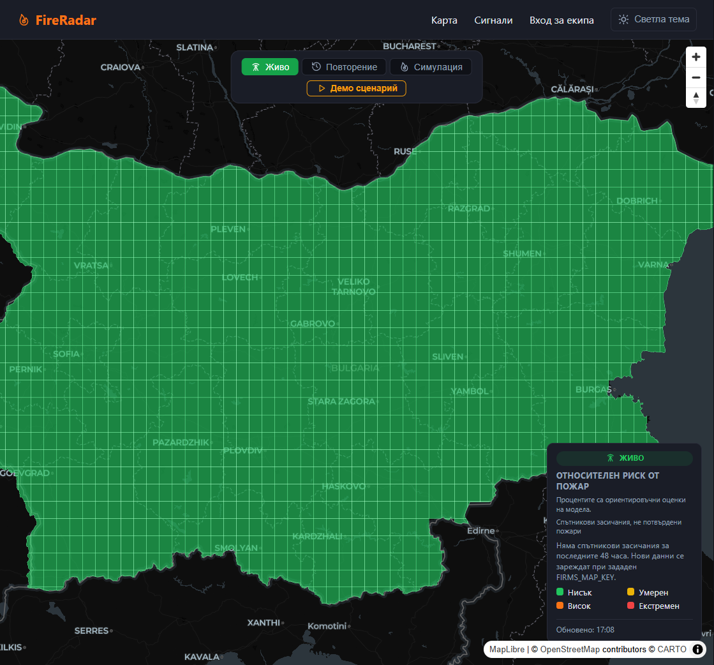
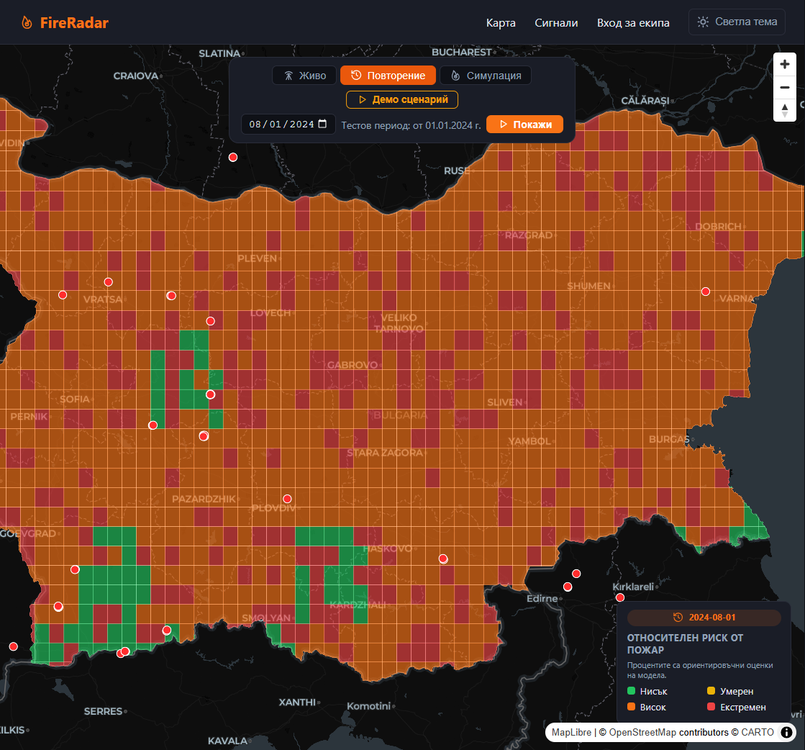
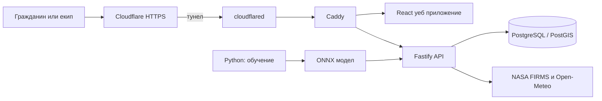

<div align="center">

# 🔥 FireRadar

**Система за наблюдение и оценка на пожарния риск в България, с граждански сигнали и диспечерски панел.**

[](https://github.com/urgeorgi09/FireRadar/actions/workflows/ci.yml)


[Живата система](https://fireradar-bg.org) ·
[Екипен вход](https://admin.fireradar-bg.org) ·
[API документация](https://fireradar-bg.org/docs) ·
[Технически справочник](PROJECT_GUIDE.md) ·
[Резултати на модела](results.md)

</div>

---

FireRadar събира на една карта метеорологични данни, сателитни засичания и оценка на пожарния риск за територията на България. Гражданите разглеждат картата и подават анонимни сигнали, а диспечерите и администраторите работят в отделен защитен интерфейс.

> **Това е прототип за демонстрация и подпомагане на наблюдението.** Не замества официалните служби и не е канал за спешни повиквания. При опасност за живот се обадете на **112**. Наблюдателните кули и дроновете са симулирани, а оценката на риска е относителна, не вероятност.

## Какво получавате

- **Карта на риска** с 1 358 клетки (мрежа 0,1°), изрязани по реалната граница на България, със светла и тъмна тема и мобилен изглед за работа с един палец.
- **Три режима:** на живо, историческо повторение (от 2024 г. нататък, с бутон за най-активния ден) и учебна симулация на разпространение на огън.
- **Сателитни засичания** от NASA FIRMS (VIIRS): история за 2018-2025 г. и почасово обновяване на последните два дни.
- **Fire Weather Index (FWI)** по Van Wagner (1987) със запазено състояние между дните и **LightGBM модел**, експортиран в ONNX, с автоматичен преход към FWI при липса на модела.
- **Анонимни граждански сигнали** с проверка на координатите в България, Cloudflare Turnstile и ограничаване на заявките.
- **Диспечерски панел:** обработка на сигнали, оперативна карта с кули, мисии и дронове (симулация).
- **Администраторски панел:** потребители и роли, журнал на действията, статистика и ключове за сензори.
- **Сензорен вход:** `POST /sensors/tower-alert` с ключ `X-API-Key`, готов за свързване на реални кули.

## Как работи

1. **Подготовка на данните.** Скриптовете изтеглят границата, земното покритие (CORINE) и историческите засичания. При първия старт API генерира клетките и ги записва в PostGIS.
2. **Всеки час** API изтегля метеорологични данни от Open-Meteo (60 дни история и 3 дни прогноза) за 78 точки на мрежа от 0,5°, интерполира ги за всяка клетка (IDW, 4 най-близки точки) и изчислява FWI и риск. Резултатът се записва за три дни напред.
3. **Всеки час** се зареждат и последните засичания от FIRMS.
4. **Картата** опреснява клетките приблизително всяка минута, а засиченията на пет минути (периодично опресняване, не постоянен поток).
5. **Гражданин** подава сигнал. API проверява Turnstile, ограничението на заявките и дали точката е в България, записва го и автоматично изпраща най-близкия свободен разузнавателен дрон (симулация).
6. **Диспечер** потвърждава или отхвърля сигнала, може да изпрати водоноска (след потвърждение) и да го отбележи като угасен. Всяко действие се записва в журнала.

## Изгледи

| Карта (на живо) | Повторение |
|---|---|
|  |  |

<!-- Добави: мобилна карта, подаване на сигнал, диспечерски панел, админ панел -->

Оперативният и административният панел изискват екипен акаунт. В хранилището няма споделени пароли; тестови акаунти за комисията са предоставени отделно.

## Данни и източници

| Данни | Източник | Предназначение |
|---|---|---|
| Сателитни засичания | [NASA FIRMS](https://firms.modaps.eosdis.nasa.gov/) (VIIRS: Suomi-NPP, NOAA-20, NOAA-21) | история и живи точки |
| Метеорология | [Open-Meteo](https://open-meteo.com/) | вход за FWI и модела |
| Земно покритие | Copernicus CORINE Land Cover 2018 | признак за модела |
| Граница на България | GADM | изрязване на клетките |

**Важно:** FIRMS показва спътникови засичания на топлинни източници. Те могат да включват и непожарни източници и **не са потвърдени пожари**. Ако `FIRMS_MAP_KEY` липсва, живият слой не се обновява, а празна карта не означава, че няма пожари.

## Модел и оценка на риска

Пожарите са рядко събитие: около **0,36%** от клетка-дните в тестовата извадка (2024 г.). Затова точността е ниска за всеки метод.

| Показател (тест 2024 г.) | FWI (база) | LightGBM (ONNX) |
|---|---|---|
| AUC | 0,689 | **0,706** |
| Precision при реалната честота | 0,6% | **0,8%** |
| Recall при избрания праг | **53,4%** | 37,8% |

Прагът е 85-ият процентил на оценките от обучението. Моделът подрежда зоните малко по-добре и е по-точен в онова, което маркира, но хваща по-малко от засиченията. Затова **резултатът е относителен риск за приоритизиране на зони, не калибрирана вероятност**, и така се обозначава навсякъде в интерфейса. Подробности и методология: [results.md](results.md).

## Сигурност

- **Роли** (администратор, диспечер, анонимен гражданин), проверявани на сървъра при всяка заявка, не само в интерфейса.
- **JWT** с 15-минутен живот и подновяване, хеширани пароли (bcrypt), хеширани ключове за сензори (SHA-256).
- **Ограничаване на заявките:** вход 10 на 15 минути, сигнали 5 на час на IP адрес. Реалният адрес идва от `CF-Connecting-IP` през доверения прокси.
- **Cloudflare Turnstile** на публичната форма. Без ключове подаването е изключено (отказва се с `503`).
- Проверка на входа със **Zod**, параметризирани SQL заявки, **Helmet** и политика за съдържанието (CSP), CORS само със списък от адреси, текстови (не HTML) изскачащи прозорци.
- **Журнал на действията** (audit log), записван в същата транзакция като промяната.
- Защита от двойно изпращане на един дрон: `FOR UPDATE SKIP LOCKED`.
- Известно ограничение: токенът за достъп е в `localStorage`. Смекчено е с кратък живот и CSP, а следваща стъпка е `httpOnly` бисквитка.

## Архитектура



| Модул | Роля |
|---|---|
| [`web/`](web) | React, TypeScript, Vite, MapLibre: публична карта, сигнали, оперативен и админ панел |
| [`api/`](api) | Fastify и TypeScript: REST API, периодични задачи, FWI, ONNX inference |
| [`ml/`](ml) | Python и LightGBM: обучение, експорт в ONNX, метаданни на модела |
| PostgreSQL / PostGIS | клетки, засичания, прогнози, сигнали, кули, дронове, потребители, журнал |
| Caddy и Cloudflare Tunnel | вътрешно маршрутизиране и публичен HTTPS без отворени входящи портове |

## API (основни маршрути)

Пълното описание е в Swagger: [`/docs`](https://fireradar-bg.org/docs). През Caddy префиксът е `/api`.

| Префикс | Маршрути | Достъп |
|---|---|---|
| `/risk` | `GET /cells`, `GET /fires/recent`, `GET /fires/:date`, `GET /replay/:date`, `POST /simulate` | публичен |
| `/alerts` | `POST /` (анонимен сигнал); `GET /`, `PATCH /:id` | публичен; диспечер и админ |
| `/towers`, `/drones` | кули, мисии, изпращане на дронове | диспечер и админ |
| `/sensors` | `POST /tower-alert` (с `X-API-Key`), управление на ключове | сензор; админ |
| `/admin` | потребители, роли, журнал, статистика | админ |
| `/auth` | `POST /login`, `POST /refresh`, `GET /me` | екип |
| `/health` | проверка за наличност | публичен |

## Структура на хранилището

```text
.
├── api/                 Fastify API (src/db, jobs, routes, scripts, services)
├── web/                 React приложение (src/components, hooks, lib, pages)
├── ml/                  обучение и ONNX модел
├── data/                входни данни (големите файлове не са в Git)
├── .github/workflows/   автоматична проверка (CI)
├── docker-compose.yml   db, api, web, caddy, cloudflared
├── Caddyfile            вътрешно маршрутизиране
├── download_geodata.py  сваляне на граница и CORINE
├── download_firms_full.py  сваляне на историческите засичания
├── results.md           резултати и ограничения на модела
└── PROJECT_GUIDE.md     подробен технически справочник
```

## Бързо локално стартиране

Нужни са Docker Compose и Python 3 (за подготовка на данните).

**1. Данни** (в главната папка, нужен е личен [FIRMS ключ](https://firms.modaps.eosdis.nasa.gov/api/area/)):

```bash
python3 -m pip install -r requirements.txt
python3 download_geodata.py
python3 download_firms_full.py --firms-key "<ВАШИЯТ_КЛЮЧ>"
```

**2. `.env`** в главната папка:

```env
JWT_SECRET=<дълга-случайна-тайна>
POSTGRES_PASSWORD=<силна-парола>
ALLOWED_ORIGINS=http://localhost:5173,http://admin.localhost:5173
TUNNEL_TOKEN=local
```

`TUNNEL_TOKEN` е задължителна променлива във файла, но не се ползва локално.

**3. Старт:**

```bash
docker compose up --build db api web
```

- Карта и сигнали: <http://localhost:5173>
- Екипен вход: <http://admin.localhost:5173>
- API и Swagger: <http://localhost:3001/docs>

**4. Екипни акаунти** (паролите са поне 14 знака):

```bash
read -rp "Admin email: " ADMIN_EMAIL
read -rsp "Admin password: " ADMIN_PASSWORD; echo
read -rp "Dispatcher email: " DISPATCHER_EMAIL
read -rsp "Dispatcher password: " DISPATCHER_PASSWORD; echo
export ADMIN_EMAIL ADMIN_PASSWORD DISPATCHER_EMAIL DISPATCHER_PASSWORD
docker compose exec -e ADMIN_EMAIL -e ADMIN_PASSWORD -e DISPATCHER_EMAIL -e DISPATCHER_PASSWORD api npm run provision:users
unset ADMIN_EMAIL ADMIN_PASSWORD DISPATCHER_EMAIL DISPATCHER_PASSWORD
```

Подаването на сигнали изисква `VITE_TURNSTILE_SITE_KEY` и `TURNSTILE_SECRET_KEY` (за тестове Cloudflare предлага тестови ключове). Без тях формата е изключена по дизайн. Живите засичания изискват `FIRMS_MAP_KEY`.

## Тестове

```bash
# API: 55 автоматични теста (Vitest)
cd api && npm ci && npm test && npm run build

# Уеб: статичен анализ и production build
cd ../web && npm ci && npm run lint && npm run build

# ML обработка (2 теста)
cd .. && python -m unittest ml.test_train
```

Интеграционният тест за миграциите на базата се изпълнява при зададена `MIGRATION_TEST_DATABASE_URL` (в CI работи с временна PostGIS база). При всяка промяна GitHub Actions пуска тестовете, проверката на кода и сглобяването на контейнерите.

## Разгръщане (production)

Системата работи на собствен Ubuntu сървър зад **Cloudflare Tunnel**: HTTPS прекратява Cloudflare, `cloudflared` се свързва навън, а Caddy слуша само вътрешно по HTTP. Не са нужни отворени входящи портове.

`.env` на сървъра (нови тайни, различни от локалните):

| Променлива | Предназначение |
|---|---|
| `JWT_SECRET`, `POSTGRES_PASSWORD` | тайни (генерират се с `openssl rand`) |
| `ALLOWED_ORIGINS` | само `https://fireradar-bg.org`, `https://www.fireradar-bg.org`, `https://admin.fireradar-bg.org` |
| `VITE_TURNSTILE_SITE_KEY`, `TURNSTILE_SECRET_KEY` | Turnstile (публичният ключ се вгражда при build) |
| `FIRMS_MAP_KEY` | почасово зареждане на засичания |
| `TUNNEL_TOKEN` | токен на Cloudflare тунела |

```bash
docker compose up --build -d
```

В Cloudflare Zero Trust тунелът публикува трите адреса към `http://caddy:80`. Адресът на Caddy (`172.30.0.2`) е фиксиран и защитен с `ip_range` на мрежата, за да не го заема друг контейнер след рестарт. Само този прокси е доверен за адреса на клиента.

**Поддръжка:**

- Проверка за наличност: `GET /api/health` (следи се с UptimeRobot).
- Ежедневен архив на базата с `pg_dump` (cron в 03:00), пази се 14 дни, проверено е възстановяването.
- Контейнерите се стартират сами при рестарт на сървъра (`restart: unless-stopped`).
- Ако базата е създадена, промяната на `POSTGRES_PASSWORD` в `.env` не променя паролата в нея.

## Ограничения

- Рискът е **относителен** и **некалибриран**; моделът не пази по-висок обхват от FWI при избрания праг.
- FIRMS засиченията не са потвърдени пожари.
- Метеорологичните данни идват от мрежа от 0,5° (78 точки), затова съседни клетки могат да имат близки стойности.
- Кулите, сигналите от тях и дроновете са **симулация**. Няма връзка с физически устройства или диспечерска система.
- Интерфейсът опреснява данните периодично (polling), не чрез постоянна връзка.
- Токенът за достъп е в `localStorage` (виж „Сигурност").
- Няма известяване на гражданите (бот и известия са извън обхвата).

## Лиценз и източници

Кодът е под лиценза [GNU Affero General Public License v3.0](LICENSE) (`AGPL-3.0-only`). Можете да го ползвате, изучавате, променяте и споделяте. Ако разпространявате променена версия или я пускате като мрежова услуга, трябва да направите изходния код на промените достъпен под същия лиценз.

Данните принадлежат на съответните доставчици (NASA FIRMS, Open-Meteo, Copernicus, GADM) и се ползват при техните условия.

Литература: Van Wagner, C. E. (1987), *Development and Structure of the Canadian Forest Fire Weather Index System*; Ke, G. и др. (2017), *LightGBM: A Highly Efficient Gradient Boosting Decision Tree*.

Проектът е разработен от Георги Урумов за Националния есенен турнир по информационни технологии „Джон Атанасов“.